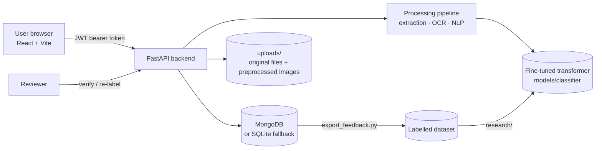

# AI Scategorizer: Project Documentation

An enterprise document classification and routing system with a human in the loop.
Users upload a document (PDF, Word, Excel, text or a scanned image). The system
extracts the text, running OCR on scans, then classifies the document into a
department: **FINANCE, HR, LEGAL or OPERATIONS**. It also scores urgency, writes
a short summary and extracts key entities.

What happens next depends on the model's confidence. A confident prediction is
**routed automatically** to that department. Otherwise the document goes to a
**Human Verification Queue**, where a department reviewer confirms or corrects
the category. Every action is recorded in an audit log.

This document explains what the project does, how each part works, how to run
it, and how to use it as the basis for a research paper.

---

## Contents

1. [Problem and approach](#1-problem-and-approach)
2. [System architecture](#2-system-architecture)
3. [Processing pipeline, step by step](#3-processing-pipeline-step-by-step)
4. [Classification and confidence-based routing](#4-classification-and-confidence-based-routing)
5. [Users, roles and access control](#5-users-roles-and-access-control)
6. [Data model](#6-data-model)
7. [REST API](#7-rest-api)
8. [Frontend](#8-frontend)
9. [Project structure](#9-project-structure)
10. [Installation and running](#10-installation-and-running)
11. [Testing](#11-testing)
12. [Research guide: turning this into a paper](#12-research-guide-turning-this-into-a-paper)
13. [Limitations and ethics](#13-limitations-and-ethics)
14. [Change log: review fixes](#14-change-log-review-fixes)

---

## 1. Problem and approach

Organisations receive a steady stream of mixed documents: invoices, resumes,
contracts, legal notices and incident reports. Many arrive as scans, and in India
many are in Hindi or mix Hindi and English. Sorting them by hand is slow.
Sorting them fully automatically is risky, because a misrouted legal notice can
miss a deadline.

AI Scategorizer handles this with **selective automation**:

- A fine-tuned transformer classifier predicts the department and outputs a **probability for each class**.
- Only predictions **at or above a confidence threshold** are auto-routed.
- Everything else, including blank or unreadable documents, goes to a human reviewer.
- The reviewer's decision is stored **next to** the model's original prediction. That gives two things:
  1. a measurable record of how often humans override the model, and
  2. new labelled training data.

The threshold sets the trade-off: a higher threshold means fewer routing errors
but more manual work. Section 12 shows how to choose it from data.

---

## 2. System architecture



| Layer | Technology |
|---|---|
| Frontend | React 19, Vite, React Router, Axios, Lucide icons |
| API | FastAPI, Pydantic v2, JWT (python-jose), bcrypt |
| Storage | MongoDB when reachable, otherwise a local SQLite document store (`backend/metromind.db`) |
| Text extraction | PyMuPDF (PDF), python-docx (DOCX), openpyxl (XLSX) |
| OCR | Tesseract (`eng` + `hin`) with OpenCV preprocessing |
| Classifier | Hugging Face `transformers` sequence classifier (DistilBERT now; MuRIL or XLM-R recommended for Hindi) |
| Research | scikit-learn, SciPy, PyTorch, matplotlib |

---

## 3. Processing pipeline, step by step

Everything below runs inside `POST /api/documents/upload`
([documents.py](backend/app/api/documents.py)). The endpoint is a plain `def`,
so FastAPI runs it in a worker thread and a long OCR job does not block other
users.

| # | Step | File | What it does |
|---|---|---|---|
| 1 | Ingestion & validation | [ingestion.py](backend/app/pipeline/ingestion.py) | Accepts PDF, DOCX, XLSX, TXT, PNG and JPG up to 25 MB. Rejects empty or unsupported files. The filename is cleaned so it cannot point outside the upload folder. |
| 2 | Text extraction | [extraction.py](backend/app/pipeline/extraction.py) | Reads embedded text from digital files. A PDF with fewer than 30 characters of text is treated as a scan. |
| 3 | OCR | [ocr.py](backend/app/pipeline/ocr.py) | Renders scanned PDF pages at 300 DPI (up to 20 pages) and runs Tesseract with `eng+hin` when the Hindi language pack is installed. If OCR fails, the text is left empty and the error is recorded, so an error message is never classified as document content. |
| 3a | Image preprocessing | [preprocessing.py](backend/app/pipeline/preprocessing.py) | Grayscale → 2× upscale (if small) → CLAHE contrast → median denoise → unsharp mask → **deskew** (angle from the minimum-area rectangle around text pixels) → Otsu binarisation. The cleaned image is saved and shown to reviewers. |
| 4 | Cleaning | [cleaner.py](backend/app/pipeline/cleaner.py) | Collapses whitespace and removes control characters while keeping Devanagari. |
| 5 | Language detection | [language.py](backend/app/pipeline/language.py) | Counts Devanagari and Latin **words**. The text is "Mixed" when each script makes up at least 10% of words, otherwise the majority script wins. `langdetect` breaks ties for Latin-only text. |
| 6 | Classification | [classifier.py](backend/app/pipeline/classifier.py) | Transformer inference on the first 512 tokens, giving a category, a confidence and the full probability distribution. Text shorter than 20 characters returns `UNCLASSIFIED` with 0% confidence. |
| 7 | Priority | [priority.py](backend/app/pipeline/priority.py) | Rule-based score from 0 to 100. Adds a base value for the category and bonuses for critical, high or medium keywords, giving CRITICAL, HIGH, MEDIUM or LOW with a human-readable reason. |
| 8 | Summary | [summarizer.py](backend/app/pipeline/summarizer.py) | Extractive summary: sentences are scored by word frequency, with a bonus for the first sentences, and the top 3 are returned. |
| 9 | Entities | [ner.py](backend/app/pipeline/ner.py) | Regex-based extraction of MONEY, DATE, EMAIL, PHONE, DOCUMENT_NUMBER, PERSON and ORGANIZATION, with Hindi patterns for money and dates. |
| 10 | Sentiment | [sentiment.py](backend/app/pipeline/sentiment.py) | Bilingual word list: NEGATIVE, NEUTRAL or POSITIVE. |
| 11 | Routing | [routing.py](backend/app/pipeline/routing.py) | `confidence ≥ threshold` and a known category: route to the department as **AI VERIFIED**. Otherwise: **HUMAN VERIFICATION REQUIRED**. |
| 12 | Persist & audit | [database.py](backend/app/db/database.py) | Stores the full record and writes an `UPLOAD` audit entry. |

Steps 7 to 10 are deliberately simple, transparent heuristics. Keyword matching
uses **whole tokens** ([text_utils.py](backend/app/pipeline/text_utils.py)), so
"fire" does not match "firewall" or "fired", and आग ("fire") does not match
आगमन ("arrival"). In a paper, describe them as rule-based modules, not as
learned models.

---

## 4. Classification and confidence-based routing

### The model

The API loads whatever Hugging Face model is in `models/classifier/`, or the
folder set in the `MODEL_DIR` environment variable. The shipped model is
DistilBERT (English, uncased) fine-tuned on the four department labels. Any
model trained with [research/train_transformer.py](research/train_transformer.py)
can be dropped in by copying its `model/` folder there.

> **Hindi caveat:** the shipped DistilBERT uses an English vocabulary. Only 70
> of its 30,522 tokens contain Devanagari, and its lowercasing removes Hindi
> vowel signs. It cannot classify Hindi text reliably. Use a multilingual
> encoder such as `google/muril-base-cased` or `xlm-roberta-base` for bilingual
> claims. Comparing the two is one of the suggested research questions.

### The routing rule

```
if category is known and confidence ≥ threshold:
    status = "AI VERIFIED",  department = DEPARTMENT_MAP[category]
else:
    status = "HUMAN VERIFICATION REQUIRED",  department = "Human Verification Queue"
```

- Admins can change the threshold on the **Settings** page (0–99%). The initial value is `DEFAULT_CONFIDENCE_THRESHOLD`, 70.
- Each document records the threshold that was applied to it (`classification.threshold_used`).
- Raw softmax confidences are usually **over-confident**. Choose the threshold with `research/evaluate.py`, which calibrates the model first. Don't guess it.

### Human verification

A reviewer opens a queued document. They see the extracted text, the
probability chart and the preprocessed scan, then choose the correct category
and add notes. The backend then:

- sets the status to `HUMAN VERIFIED` and routes the document to the chosen department;
- updates `classification.predicted_category` (the **current** category);
- **keeps** `classification.model_prediction` and `model_confidence` (the model's **original** answer);
- sets `human_override = true` if the reviewer changed the category.

Only documents still waiting in the queue can be verified by department
reviewers. Re-labelling a document that has already been routed requires ADMIN.

---

## 5. Users, roles and access control

Access rules are enforced **in the backend**
([categories.py](backend/app/core/categories.py) `can_view_document`,
[deps.py](backend/app/api/deps.py) `require_roles`). The frontend only hides
menu items.

| Role | Sees documents | Verification queue | Upload | Users / Audit / Settings |
|---|---|---|---|---|
| `ADMIN` | all | yes | yes | yes |
| `FINANCE_MANAGER` | FINANCE, the queue, own uploads | yes | – | – |
| `HR_MANAGER` | HR, the queue, own uploads | yes | – | – |
| `LEGAL_COUNSEL` | LEGAL, the queue, own uploads | yes | – | – |
| `OPERATIONS_MANAGER` | OPERATIONS, the queue, own uploads | yes | – | – |
| `UPLOADER` | own uploads only | – | yes | – |

### Demo accounts

These are created at startup while `SEED_DEMO_USERS=true`. Never enable that
setting on a public server.

| Role | Email | Password |
|---|---|---|
| Admin | `admin@aiscategorizer.local` | `admin123` |
| Finance Manager | `finance@aiscategorizer.local` | `finance123` |
| HR Manager | `hr@aiscategorizer.local` | `hr123` |
| Legal Counsel | `legal@aiscategorizer.local` | `legal123` |
| Operations Manager | `operations@aiscategorizer.local` | `ops123` |
| Uploader | `uploader@aiscategorizer.local` | `user123` |

Authentication uses a JWT bearer token, valid for 24 hours and signed with
`SECRET_KEY`. Passwords are hashed with bcrypt.

---

## 6. Data model

A stored document (Mongo document or SQLite JSON row):

```jsonc
{
  "_id": "uuid",
  "original_filename": "invoice_123.pdf",
  "file_type": "PDF",
  "uploader_id": "...", "uploader_name": "...", "upload_timestamp": "ISO-8601",
  "extracted_text": "...",
  "language": "English | Hindi | Mixed (Hindi + English)",
  "ocr_metadata": { "ocr_used": true, "language": "eng+hin", "preprocessing_applied": [...],
                    "pages_processed": 1, "error": null, "preprocessed_image_url": "/api/documents/preprocessed-image/..." },
  "classification": {
    "predicted_category": "FINANCE",     // current category (after any human correction)
    "confidence": 91.4,                  // %
    "probabilities": { "FINANCE": 91.4, "HR": 2.1, "LEGAL": 3.0, "OPERATIONS": 3.5 },
    "model_prediction": "FINANCE",       // original model output, never overwritten
    "model_confidence": 91.4,
    "model_name": "distilbert-base-uncased",
    "threshold_used": 70.0
  },
  "priority": { "level": "MEDIUM", "score": 55, "reason": "..." },
  "summary": "• ...", "sentiment": { "label": "NEUTRAL", "score": 0.75 },
  "entities": [ { "text": "INV-4029", "label": "DOCUMENT_NUMBER" } ],
  "assigned_department": "Finance Manager",
  "verification_status": "AI VERIFIED | HUMAN VERIFICATION REQUIRED | HUMAN VERIFIED",
  "verified_category": null, "verifier_id": null, "verifier_name": null,
  "verification_notes": null, "verification_timestamp": null, "human_override": false
}
```

Other collections:
- `users`: email, name, role, bcrypt hash, active flag.
- `audit_logs`: user, action, document, details, timestamp. Actions are LOGIN, UPLOAD, DOCUMENT_VIEWED, DOCUMENT_DELETED, HUMAN_VERIFIED, USER_CREATED, ROLE_CHANGED and SETTINGS_CHANGED.
- `settings`: `confidence_threshold`.

---

## 7. REST API

Interactive documentation is at `http://localhost:8000/api/docs`.

| Method | Path | Who | Purpose |
|---|---|---|---|
| POST | `/api/auth/login` | anyone | Email and password; returns a JWT and the user |
| GET | `/api/auth/me` | logged in | Current user |
| POST | `/api/documents/upload` | logged in | Upload and process a file (multipart `file`) |
| GET | `/api/documents` | logged in | List visible documents. Filters: `search`, `category`, `priority`, `status_filter`, `language` |
| GET | `/api/documents/{id}` | allowed viewers | Full document record |
| DELETE | `/api/documents/{id}` | owner or admin | Delete the record and its stored files |
| GET | `/api/documents/preprocessed-image/{name}` | public (unguessable UUID name) | Preprocessed scan preview |
| GET | `/api/verification` | reviewers, admin | Documents awaiting review |
| POST | `/api/verification/verify/{id}` | reviewers, admin | `{verified_category, notes}` |
| GET | `/api/dashboard/stats` | logged in | Counts by status, category, priority and language, plus average confidence |
| GET/POST/PATCH | `/api/users[/{id}]` | admin | User management |
| GET | `/api/audit-logs` | admin | Latest 200 audit entries |
| GET/PATCH | `/api/settings` | read: logged in, write: admin | Threshold (0–100), model info |

---

## 8. Frontend

`frontend/src/`. The API address comes from `VITE_API_URL` (default `http://localhost:8000`).

| Page | Purpose |
|---|---|
| Login | Sign in, or pick a demo account |
| Dashboard | Totals, category, priority and language breakdowns, recent and critical documents |
| Documents | Searchable, filterable list (only what the role may see) |
| Document detail | Text, summary, entities, sentiment, probability chart, preprocessed scan, verification form |
| Upload | Drag-and-drop upload with the processing result |
| Human Verification | The review queue |
| Users / Audit Logs / Settings | Admin pages (threshold slider, active model) |
| Profile | The current user's permissions |

Shared role and category constants live in
[constants.js](frontend/src/constants.js) and mirror
[categories.py](backend/app/core/categories.py).

---

## 9. Project structure

```
AI_Scategorizer/
├── backend/
│   ├── app/
│   │   ├── api/            # FastAPI routers (auth, documents, verification, dashboard, users, audit, settings)
│   │   ├── core/           # config.py (settings/.env), security.py (JWT, bcrypt), categories.py (taxonomy + RBAC)
│   │   ├── db/             # database.py: MongoDB adapter with SQLite fallback
│   │   ├── models/         # Pydantic schemas
│   │   └── pipeline/       # ingestion, extraction, ocr, preprocessing, cleaner, language,
│   │                       # classifier, priority, summarizer, ner, sentiment, routing, text_utils
│   ├── uploads/            # stored files, rendered PDF pages, preprocessed images (git-ignored)
│   └── requirements.txt
├── frontend/               # React app
├── models/classifier/      # fine-tuned HF model served by the API (weights git-ignored)
├── research/               # reproducible experiments for the paper (see §12)
│   ├── data/README.md      # dataset format + labelling guideline
│   ├── split_dataset.py  train_baseline.py  train_transformer.py  predict_with_model.py
│   ├── evaluate.py  export_feedback.py  ocr_ablation.py  common.py
│   └── requirements.txt
├── scripts/                # seed_db.py, run_all.sh (macOS/Linux), run_all.ps1 (Windows)
├── tests/                  # pytest: pipeline unit tests + API/RBAC integration tests
├── .env.example
└── PROJECT.md              # this file
```

---

## 10. Installation and running

### Prerequisites

- Python 3.11 or 3.12. Some pinned scientific packages don't yet ship wheels for the newest Python releases.
- Node.js 20+
- **Tesseract OCR** with the Hindi language pack:
  - Windows: install from the UB Mannheim Tesseract build and tick **Hindi** under additional languages. It installs to `C:\Program Files\Tesseract-OCR`, which the app finds automatically.
  - macOS: `brew install tesseract tesseract-lang`
  - Ubuntu: `sudo apt install tesseract-ocr tesseract-ocr-hin`
- Optional: MongoDB. Without it, the app uses SQLite automatically.

### Backend

```bash
python -m venv backend/venv
# Windows: backend\venv\Scripts\activate     macOS/Linux: source backend/venv/bin/activate
pip install -r backend/requirements.txt
cp .env.example .env        # then set SECRET_KEY
python -m uvicorn backend.app.main:app --host 127.0.0.1 --port 8000 --reload
```

Run commands from the project root (`AI_Scategorizer/`).

### Frontend

```bash
cd frontend
npm install
npm run dev                 # http://localhost:5173
```

To start both on Windows: `powershell -ExecutionPolicy Bypass -File scripts\run_all.ps1`. On macOS/Linux: `./scripts/run_all.sh`.

### Model

Put a fine-tuned model in `models/classifier/`: `config.json`, `model.safetensors`
and the tokenizer files. Without one the app still runs, and every document goes
to human review. Model weights are git-ignored because they are too large. Share
them through the Hugging Face Hub, Google Drive or Git LFS.

---

## 11. Testing

```bash
python -m pytest tests -v
```

The tests use a **temporary database and upload folder** and a **stubbed
classifier** ([conftest.py](tests/conftest.py)), so they never modify your real
data and don't need the model or GPU.

| File | Covers |
|---|---|
| [test_pipeline.py](tests/test_pipeline.py) | validation, language detection, whole-token keyword matching, empty-text routing, priority, NER (no word fragments), sentiment, routing, deskew accuracy on synthetic rotated pages |
| [test_api.py](tests/test_api.py) | login, auth required, auto-routing, department RBAC, human verification (and that the model prediction is preserved), empty upload → queue, upload filename traversal, preprocessed-image traversal, threshold validation, dashboard |

Model quality is **not** measured by unit tests. That is what `research/evaluate.py` is for.

---

## 12. Research guide: turning this into a paper

The application on its own is an engineering project. A paper needs a
**question, a dataset and a fair evaluation**. The `research/` folder provides
the evaluation machinery. You provide the labelled data.

### 12.1 Suggested research questions

| | Question | What you report | Effort |
|---|---|---|---|
| **RQ1 (main)** | How much manual review can confidence-based selective routing remove while keeping routing accuracy at or above a target (e.g. 95%)? | Accuracy of auto-routed documents vs % auto-routed; the threshold chosen on validation and its test result; AURC; effect of calibration (ECE before and after temperature scaling) | Low; uses the existing system |
| **RQ2** | Do multilingual encoders (MuRIL, XLM-R, mBERT) beat English DistilBERT and a TF-IDF baseline on Hindi and code-mixed enterprise documents? | Macro-F1 per language (English, Hindi, Mixed) with 95% CIs, McNemar significance tests, model size and inference time | Medium; needs Hindi data |
| RQ3 (optional) | Which OCR preprocessing steps actually reduce error on scanned bilingual documents? | CER/WER for no preprocessing, the full pipeline, and the full pipeline minus one step | Medium; needs transcribed scans |

A good paper for a student or regional IEEE/Springer conference: **RQ1 + RQ2**.
Title idea: *"Calibrated Human-in-the-Loop Routing of Bilingual (Hindi–English)
Enterprise Documents with Multilingual Transformers."*

### 12.2 Experiment workflow

```bash
pip install -r research/requirements.txt

# 1. Build research/data/dataset.csv: either automatically from 7 public Hugging Face corpora
python research/build_dataset.py --per-class 300
#    or by hand (format + labelling rules: research/data/README.md)
# 2. One fixed, de-duplicated, stratified split shared by every model
python research/split_dataset.py --input research/data/dataset.csv --out research/data/splits

# 3. Baseline (CPU, minutes)
python research/train_baseline.py --out research/results/tfidf_lr

# 4. Transformers (GPU recommended, e.g. free Colab T4)
python research/train_transformer.py --model-name distilbert-base-uncased            --out research/results/distilbert
python research/train_transformer.py --model-name distilbert-base-multilingual-cased --out research/results/mdistilbert
python research/train_transformer.py --model-name google/muril-base-cased            --out research/results/muril
python research/train_transformer.py --model-name xlm-roberta-base                   --out research/results/xlmr

# (optional) evaluate the model the app currently serves, without retraining
python research/predict_with_model.py --model-dir models/classifier --out research/results/deployed

# 5. Evaluate everything; writes research/results/report/results.md + per-run figures
python research/evaluate.py research/results/tfidf_lr research/results/distilbert research/results/muril research/results/xlmr --target-accuracy 0.95

# 6. Deploy the winner and set the app threshold to the value evaluate.py chose
cp -r research/results/muril/model/* models/classifier/
```

**Cross-source evaluation (recommended):** add `--holdout-source <source>` to `split_dataset.py` so that every document from one source becomes the test set. This measures how the model copes with a document source it has never seen, and is far more realistic than a random split. `research/colab_experiments.ipynb` runs the full set of experiments on a free Colab GPU.

For seed variance, repeat step 4 with `--seed 1`, `--seed 2` and `--seed 3`, and
report mean ± standard deviation.

### 12.3 What `evaluate.py` produces

For every run, in `<run>/eval/`:
- `metrics.json`: accuracy and macro-F1 with **95% bootstrap CIs**, per-class precision, recall and F1, **per-language** results, confusion matrix, calibration (temperature, ECE, NLL and Brier before and after), and selective-routing results.
- `threshold_sweep.csv`: for thresholds 0.00–0.95, the % auto-routed, % sent to review, accuracy of auto-routed documents, misrouted documents per 1,000, and overall accuracy with review.
- `confusion_matrix.png`, `reliability.png`, `threshold_tradeoff.png`: figures ready for the paper.
- `errors.csv`: misclassified test documents for the error-analysis section.

Across runs, `research/results/report/results.md` has the main comparison
table, the per-language table and **paired McNemar tests**.

**Fairness rules built into the scripts:** hyperparameters, temperature and
routing threshold are all chosen on **validation**, and the test set is used
once for reporting. Duplicate texts are removed before splitting.

### 12.4 Closing the loop with real usage

`python research/export_feedback.py` exports every human-verified document
together with the model's original prediction. Use it to:
- report the **live human-override rate** (how often reviewers disagreed with the model), and
- add real labelled documents to the dataset for the next training round, which is an active-learning angle you can describe as future work.

### 12.5 Paper outline

1. **Introduction**: the manual document triage problem, the risk of full automation, and Hindi–English documents in Indian organisations. List your contributions.
2. **Related work**: document image classification (RVL-CDIP and layout models), multilingual and Indic encoders (mBERT, XLM-R, MuRIL), selective classification and calibration (temperature scaling, risk–coverage), and human-in-the-loop systems.
3. **System**: architecture diagram (§2), pipeline (§3), routing rule (§4).
4. **Dataset**: sources, labelling guideline, inter-annotator agreement (Cohen's κ), statistics by class and language, and the split.
5. **Experimental setup**: models, hyperparameters, hardware, seeds and metrics.
6. **Results**: the main table, per-language table, calibration, the threshold trade-off figure, and significance tests.
7. **Error analysis**: confusion pairs (e.g. FINANCE vs LEGAL for contract payments), OCR-noise failures.
8. **Limitations and ethics** (§13).
9. **Conclusion and future work.**

### 12.6 Reproducibility checklist

- [ ] Dataset sources and licences documented; personal data removed
- [ ] `split_info.json` and the split CSVs archived (or their hashes reported)
- [ ] Every number in the paper traceable to a `metrics.json`
- [ ] Seeds, library versions (`pip freeze`) and GPU type recorded
- [ ] Threshold and temperature chosen on validation only
- [ ] Code and trained models released (GitHub + Hugging Face Hub), or reasons stated

---

## 13. Limitations and ethics

- **Rule-based components.** Priority, sentiment, NER and summarisation are heuristics. Their outputs help reviewers but have not been evaluated as models.
- **Truncation.** The classifier reads the first 512 tokens, about 350–400 words. Long documents whose key content comes later may be misclassified.
- **The shipped English model and Hindi.** See the caveat in §4. Don't claim bilingual classification accuracy without RQ2 results.
- **Confidence is not correctness.** Even calibrated confidence can be wrong under distribution shift, for example a new document template. Monitor the override rate and re-calibrate on fresh data.
- **Privacy.** Documents may contain personal data such as resumes or salary details. Restrict access, anonymise any data you publish, and don't commit `backend/uploads/` or the database.
- **Security scope.** The app is a prototype: tokens live in browser `localStorage`, there is no rate limiting, and preview images are served without a token (their names are random UUIDs). Harden these before a real deployment.

---

## 14. Change log: review fixes

Changes made to bring the code base to a consistent, research-ready state:

**Consistency**
- One taxonomy (FINANCE / HR / LEGAL / OPERATIONS) and one role set across the backend, frontend, seed data, tests and docs. The leftover MetroMind SAFETY/MAINTENANCE and Station Controller/Maintenance Head references were removed.
- The new manager roles (HR, Legal, Operations) can now see their documents, the queue and the sidebar.

**Correctness**
- Blank or unreadable documents and OCR failures now go to human review instead of being auto-approved as OPERATIONS.
- Human verification keeps the model's original prediction (`model_prediction`, `human_override`) so model accuracy can be measured.
- Keyword matching uses whole tokens. This fixes "Firewall" → CRITICAL, आगमन ("arrival") → fire emergency, and "Goods" → POSITIVE.
- The entity extractor no longer produces fragments such as `umentation` from "Documentation".
- Language detection is word-based, so one English acronym no longer makes a Hindi document "Mixed".
- The deskew angle was rewritten to work with current OpenCV and is unit-tested on synthetically rotated pages. Sharpening now happens before binarisation.
- The confidence threshold has a single default, validated to 0–100.

**Security**
- Upload filenames are reduced to their base name, and the preview-image endpoint rejects path traversal. Both previously allowed `..\` paths on Windows.
- Department RBAC is enforced for single-document access, not just lists.
- `SECRET_KEY` and other settings load from `.env`. The app warns when the development key is in use.
- CORS is limited to configured origins. Demo-user seeding can be disabled. The real client IP is logged at login.

**Performance and housekeeping**
- Upload processing no longer blocks the server's event loop. OCR is capped at 20 pages.
- Deleting a document also deletes its stored files.
- Model files moved to `models/classifier/` and git-ignored. Obsolete TF-IDF/metro training code and `calibrate.py` were removed and replaced by `research/`.
- Unused dependencies removed (spaCy, NLTK, motor, pdf2image, passlib). Tests are isolated from real data.
